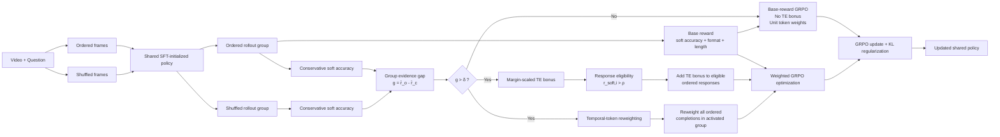

# Selective TE-CGRPO: Margin-Gated Temporal Evidence for Video MLLMs

<p align="center">
  <b>Selective Temporal-Evidence Contrastive GRPO for more reliable temporal reasoning in Video MLLMs</b>
</p>

<p align="center">
  
  
  
  
</p>

## Overview

**Selective TE-CGRPO** (Selective Temporal-Evidence Contrastive Group Relative Policy Optimization) is a reinforcement-learning method for temporal reasoning in multimodal large language models (MLLMs).

The method extends Video-R1's Temporal GRPO (T-GRPO) by addressing two limitations of response-level temporal credit:

1. **Weak and strong ordered–shuffled gaps should not receive the same temporal reward.**
2. **Temporal credit should not be distributed uniformly across all completion tokens.**

Selective TE-CGRPO therefore introduces:

- **Conservative soft-accuracy supervision** for partially valid / non-canonical answers.
- **Margin-gated temporal-evidence reward**, activated only when the ordered video clearly outperforms its shuffled counterpart.
- **Positive-gap-activated temporal-token reweighting**, which concentrates token-level credit on temporal expressions and their local context.
- **No additional inference-time branch or parameters**: the shuffled view is used only during RL training.

The main 7B experiment starts from **Qwen2.5-VL-7B-COT-SFT** and trains for 1,000 RL steps. Across five benchmarks, Selective TE-CGRPO reports higher five-benchmark means than the published Video-R1-7B T-GRPO results by **+0.43, +0.87, and +0.35 points** at 16, 32, and 64 frames, respectively.

---

## Motivation

Video reasoning requires more than recognizing objects or actions. A model must preserve **event order, action progression, and state transitions**.

Video-R1/T-GRPO compares an ordered video with a shuffled version to encourage temporal sensitivity. However, a small positive ordered–shuffled gap can arise from sampling variation, and not every video question genuinely depends on temporal order.

Selective TE-CGRPO treats the shuffled branch as a **contrastive training reference**, but activates temporal supervision only when there is sufficiently strong positive evidence that preserving frame order improves answer quality.

---

## Method

### Technical Route



### 1. Ordered–Shuffled Temporal Evidence

For the same video-question pair, the policy samples an ordered rollout group and a shuffled rollout group:

\[
y_{o,i} \sim \pi_\theta(\cdot \mid v_o,q), \qquad
y_{c,k} \sim \pi_\theta(\cdot \mid v_c,q)
\]

The group-level soft-accuracy means are

\[
\bar r_o = \frac{1}{G}\sum_{i=1}^{G}r_{\text{soft}}(y_{o,i}),
\qquad
\bar r_c = \frac{1}{G_c}\sum_{k=1}^{G_c}r_{\text{soft}}(y_{c,k}),
\]

and the temporal-evidence gap is

\[
g = \bar r_o - \bar r_c.
\]

Only **soft accuracy** defines this evidence gap. Format and length rewards contribute to the base response reward, but are not interpreted as temporal evidence.

### 2. Conservative Soft Accuracy

For multiple-choice samples:

| Prediction type | Soft accuracy |
|---|---:|
| Normalized exact option | 1.0 |
| First identifiable option is correct | 0.6 |
| Correct option appears only later | 0.2 |
| Incorrect response | 0.0 |

For numerical samples:

| Numerical prediction | Soft accuracy |
|---|---:|
| Exact after rounding to 2 decimals | 1.0 |
| Relative error ≤ 1% | 0.8 |
| Relative error ≤ 5% | 0.5 |
| Relative error ≤ 10% | 0.25 |

Partial credit is used **only for training**. Benchmark evaluation follows each benchmark's official scoring rule.

The ordered-response base reward is

\[
R_i^{\text{base}}
=
r_{\text{soft},i}
+
r_{\text{fmt},i}
+
b_{\text{len},i}.
\]

### 3. Margin-Gated Temporal Reward

Instead of giving the same temporal bonus to every positive gap, Selective TE-CGRPO suppresses weak fluctuations and scales the remaining evidence:

\[
b_{\text{TE}}
=
\alpha\,
\mathrm{clip}
\left(
\frac{g-\delta}{m},
0,
1
\right).
\]

For the main 7B configuration:

- maximum temporal bonus: \(\alpha = 0.30\)
- activation threshold: \(\delta = 0.10\)
- scaling margin: \(m = 0.15\)
- answer eligibility threshold: \(\rho = 0.10\)

Thus:

- \(g \le 0.10\): no temporal bonus
- \(0.10 < g < 0.25\): bonus increases continuously
- \(g \ge 0.25\): bonus reaches the maximum \(0.30\)

The final ordered-response reward is

\[
R_i
=
R_i^{\text{base}}
+
\mathbf{1}[v\text{ is video}]
\mathbf{1}[g>\delta]
\mathbf{1}[r_{\text{soft},i}>\rho]
b_{\text{TE}}.
\]

The group gate \(g>\delta\) and the response eligibility test \(r_{\text{soft},i}>\rho\) have different roles:

- **\(g>\delta\)** activates temporal learning for the ordered group.
- **\(r_{\text{soft},i}>\rho\)** only controls which ordered responses receive the additive TE bonus.

### 4. Selective Temporal-Token Credit

For every ordered completion in an activated positive-gap video group, token aggregation is reweighted using a fixed temporal lexicon.

| Token category | Weight |
|---|---:|
| Temporal token | 1.30 |
| Adjacent to a temporal token | 1.15 |
| Ordinary token | 1.00 |
| Generic reasoning-template token | 0.95 |

Temporal expressions include order / transition words such as **before**, **after**, **then**, **first**, and **next**.

Importantly, once a video group satisfies \(g>\delta\), token reweighting is applied to **all ordered completions in that group**, regardless of whether an individual response receives the TE bonus.

For inactive video groups and image samples, all token weights remain 1.00.

---

## Algorithm

```text
1. Sample G ordered responses.
2. Compute soft-accuracy, format, and inherited length rewards.
3. If the input is a video:
   a. Shuffle the sampled frames.
   b. Generate Gc shuffled responses.
   c. Compute the group evidence gap g = r̄_o - r̄_c.
   d. Compute the margin-scaled TE bonus.
   e. If g > δ:
      - Add the TE bonus to ordered responses with r_soft > ρ.
      - Apply temporal-token weights to all G ordered completions.
4. Compute group-relative advantages.
5. Perform the GRPO policy update with KL regularization.
```

---

## Training Configuration

| Item | 7B Main | 3B Supporting Study |
|---|---|---|
| Initialization | Qwen2.5-VL-7B-COT-SFT | Qwen2.5-VL-3B-Video-COT-SFT |
| RL steps | 1,000 | 1,000 |
| Hardware | 4× A100-80GB + 1 vLLM GPU | 3× A100-40GB, no vLLM |
| Ordered / shuffled rollouts | 8 / 4 | 2 / 1 |
| Max prompt length | 16,384 | 4,096 |
| Max completion length | 768 | 192 |
| Max visual pixels | 501,760 | 401,408 |
| Learning rate | 1e-6 | 1e-6 |
| KL coefficient \(\beta\) | 0.04 | 0.04 |
| Maximum TE bonus \(\alpha\) | 0.30 | 0.50* |
| Activation threshold \(\delta\) | 0.10 | 0.10 |
| Scaling margin \(m\) | 0.15 | 0.15 |
| Eligibility threshold \(\rho\) | 0.10 | 0.10 |
| Token weights | 1.30 / 1.15 / 1.00 / 0.95 | 1.30 / 1.15 / 1.00 / 0.95 |
| Evaluation frames | 16 / 32 / 64 | 16 primary; 8 / 32 auxiliary |

\* The 3B value \(\alpha=0.50\) is the best tested value from a **post-hoc sweep on the reported benchmarks** and should not be interpreted as a universal optimum.

Training uses the filtered **Video-R1-260k** mixture with **263,005 records**:

- 146,823 image records (55.83%)
- 116,182 video records (44.17%)

The video subset includes data from LLaVA-Video, STAR, CLEVRER, PerceptionTest, and NExT-QA.

---

## Benchmarks

| Benchmark | Samples | Primary capability | Metric |
|---|---:|---|---|
| VSI-Bench | 5,130 | Spatial / embodied reasoning | Official Overall |
| MMVU | 625 | Multi-discipline video reasoning | Accuracy |
| MVBench | 4,000 | Action and temporal reasoning | Accuracy |
| TempCompass | 7,540 | Temporal order / progression | Accuracy |
| VideoMME | 2,700 | General and long-form video understanding | Accuracy |
| **Total** | **19,995** | — | — |

For VSI-Bench, the reported score is the **official equal-weight macro-average of its eight task scores**, rather than a micro-average over all 5,130 examples.

---

## Main 7B Results

### Comparison with Video-R1-7B T-GRPO

| Frames | Model | VSI-Bench | MMVU | MVBench | TempCompass | VideoMME | Mean |
|---:|---|---:|---:|---:|---:|---:|---:|
| 16 | Video-R1-7B (T-GRPO) | 34.60 | 64.20 | 62.70 | 72.60 | **57.40** | 58.30 |
| 16 | **Selective TE-CGRPO-7B** | **35.38** | **64.80** | **63.42** | **73.29** | 56.74 | **58.73** |
| 32 | Video-R1-7B (T-GRPO) | 35.80 | 63.80 | 63.90 | 73.20 | 59.30 | 59.20 |
| 32 | **Selective TE-CGRPO-7B** | **36.56** | **65.12** | **64.67** | **73.91** | **60.11** | **60.07** |
| 64 | Video-R1-7B (T-GRPO) | 37.10 | 63.80 | 64.80 | 73.20 | **61.40** | 60.06 |
| 64 | **Selective TE-CGRPO-7B** | **37.53** | **64.32** | **65.25** | **74.01** | 60.96 | **60.41** |

Five-benchmark mean improvement over the published Video-R1 results:

- **16 frames:** +0.43
- **32 frames:** +0.87
- **64 frames:** +0.35

Selective TE-CGRPO records higher reported scores in **13 of 15 benchmark–frame comparisons**, including all five benchmarks at 32 frames.

These differences are numerical comparisons from single training trajectories and should not be interpreted as cross-seed statistical significance.

---

## Supporting 3B Study

The 3B experiment independently initializes T-GRPO and Selective TE-CGRPO from the same **Qwen2.5-VL-3B-Video-COT-SFT** checkpoint.

| Frames | Model | VSI-Bench | MMVU | MVBench | TempCompass | VideoMME | Mean |
|---:|---|---:|---:|---:|---:|---:|---:|
| 8 | Video-R1 T-GRPO-3B | 32.23 | 54.88 | 55.25 | 61.75 | 47.00 | 50.22 |
| 8 | **Selective TE-CGRPO-3B** | **32.73** | **58.72** | **55.83** | **62.43** | **47.89** | **51.52** |
| 16 | Video-R1 T-GRPO-3B | 33.01 | 54.88 | 57.18 | 63.97 | 48.00 | 51.41 |
| 16 | **Selective TE-CGRPO-3B** | **34.74** | **60.48** | **57.78** | **64.12** | **49.67** | **53.36** |
| 32 | Video-R1 T-GRPO-3B | 33.95 | 57.76 | 57.40 | 64.18 | 51.15 | 52.89 |
| 32 | **Selective TE-CGRPO-3B** | **34.23** | **60.16** | **58.68** | **65.13** | **51.81** | **54.00** |

At the primary 16-frame setting, the selected 3B configuration improves the five-benchmark mean by **+1.95 points** over the matched T-GRPO control.

Because \(\alpha=0.50\) was selected using the same benchmark suite used for reporting, this result is a descriptive post-hoc comparison rather than an unbiased held-out estimate.

---

## Component Ablation

A complete \(2^3\) ablation evaluates:

1. Conservative soft accuracy
2. Margin-gated selective temporal evidence
3. Selective temporal-token reweighting

At 16 frames:

| Configuration | Five-benchmark Mean |
|---|---:|
| Video-R1 T-GRPO control | 51.41 |
| Selective TE-CGRPO-3B | **53.36** |
| w/o Soft reward | 50.89 |
| w/o Selective TE | 49.91 |
| w/o TE-Reweight | 51.07 |

Conditional decreases relative to the complete model:

- **Remove soft reward:** −2.47
- **Remove margin-gated selective TE:** −3.45
- **Remove temporal-token reweighting:** −2.28

The ablation indicates interactions among the three refinements. In particular, the factorial average does not establish a positive standalone main effect for soft accuracy, so it is best interpreted as auxiliary reward infrastructure within the complete objective.

---

## Selective-Activation Diagnostics

The 7B training trajectory logs 418 video comparisons:

- Positive gap: 97 / 418 (**23.21%**)
- Zero gap: 229 / 418 (**54.78%**)
- Negative gap: 92 / 418 (**22.01%**)
- Passed \(g>0.10\): 79 / 418 (**18.90%**)

This shows that most video comparisons retain the base reward and ordinary token aggregation; temporal enhancement is activated selectively rather than for every video sample.

---

## Training and Inference Cost

During RL training, the shuffled branch adds additional generation. In the main 7B setting,

\[
G_c / G = 4 / 8 = 0.5.
\]

The shuffled branch is removed at inference time.

Therefore, Selective TE-CGRPO:

- does **not** require a learned reward model,
- does **not** require temporal annotations,
- introduces **no additional inference-time parameters or branches**,
- retains the original model input interface at evaluation time.

---

## Reproduction Notes

This repository is intended to contain the implementation used for Selective TE-CGRPO.

Before publishing reproduction commands, please make sure the command examples exactly match the training and evaluation entry points in this repository. The paper-level settings that should remain fixed for the main 7B experiment are:

```text
RL steps:                 1000
Training frames:          16
Ordered rollouts (G):     8
Shuffled rollouts (Gc):   4
Learning rate:            1e-6
KL coefficient:           0.04
Weight decay:             0.01
Max gradient norm:        5
Max prompt length:        16384
Max completion length:    768
Max visual pixels:        501760
Generation temperature:   1.0

alpha:                    0.30
delta:                    0.10
margin m:                 0.15
eligibility rho:          0.10

temporal token weight:    1.30
adjacent-context weight:  1.15
ordinary token weight:    1.00
template token weight:    0.95
```

Evaluation uses 16 / 32 / 64 uniformly sampled frames for the 7B comparison and follows each benchmark's official answer extraction and scoring rules.

---

## Limitations

The current evidence should be interpreted with the following scope:

- Each training configuration is represented by a single 1,000-step trajectory; cross-seed variance is not measured.
- The 7B comparison uses published Video-R1 scores rather than paired multi-seed retraining.
- The 3B \(\alpha=0.50\) setting is selected post hoc on the same benchmarks used for reporting.
- Random frame shuffling is a useful contrastive intervention but is not a causal certificate of which temporal relation produced a prediction.
- Most evaluated tasks are multiple choice.
- The current ablation does not compare selective token reweighting against applying the same token weights to every video sample.

Future work includes multiple seeds, alternative temporal corruptions, all-video versus selective reweighting, free-form temporal localization, dense event annotations, and learned token-importance estimates.

---

## Citation

If you find this work useful, please cite:

```bibtex
@article{yang2026selectivete,
  title  = {Selective TE-CGRPO: Margin-Gated Temporal Evidence for Video MLLMs},
  author = {Yang, Cheng},
  year   = {2026}
}
```

---

## Acknowledgements

This work builds on the temporal reinforcement-learning framework of **Video-R1 / T-GRPO** and uses the **Qwen2.5-VL** model family as the underlying multimodal backbone.

---

## License

Please use the license file distributed with this repository and respect the licenses of the upstream models, datasets, and codebases.
